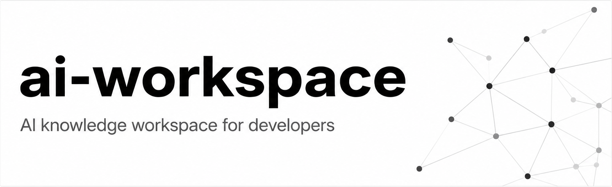
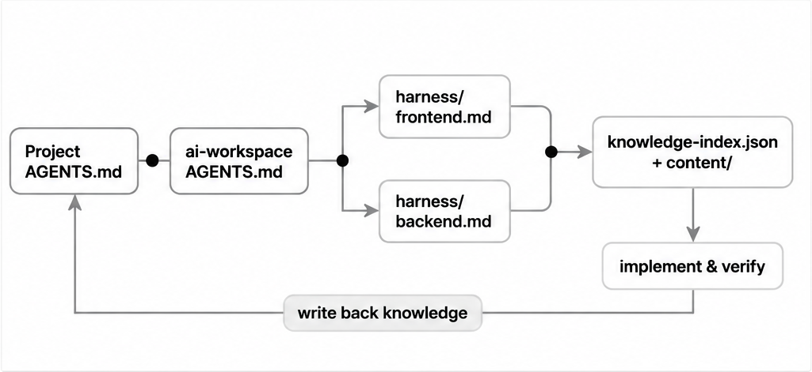
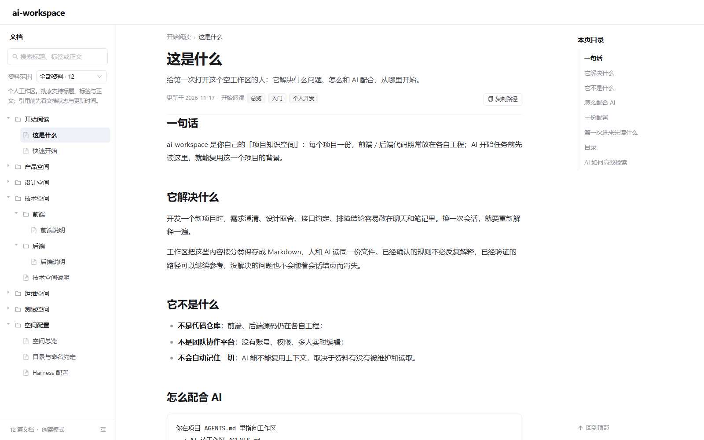
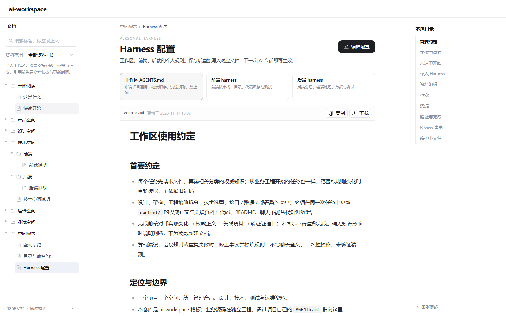
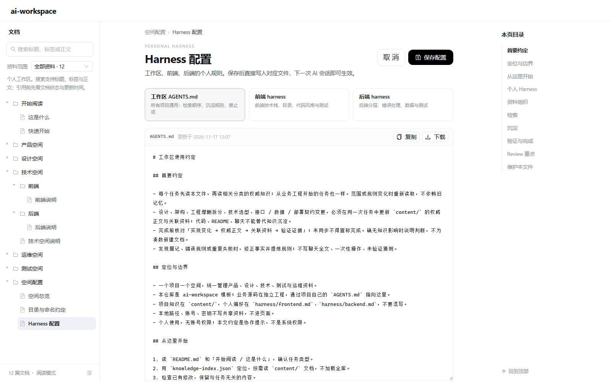

<div align="center">



<h1>ai-workspace</h1>

<p><strong>AI 统一查看的知识空间 · 一个项目一个空间</strong></p>

<p>让需求和 Agent 从同一套项目上下文开始工作</p>

<p>
  <a href="#-项目介绍">项目介绍</a> ·
  <a href="#-快速开始">快速开始</a> ·
  <a href="#-如何贡献">如何贡献</a>
</p>

<p>
  
  
  
  
</p>

</div>

---

## 📖 项目介绍

**ai-workspace** 是一个面向个人开发者的项目知识空间模板。

每个项目准备一个工作区：产品需求、设计取舍、技术决策、测试结论与运维经验按分类保存在这里；前端、后端工程仍然独立创建，只在各自的 `AGENTS.md` 中指向工作区。

当 AI 开始一个任务时，它先读工作区约定，再按索引检索项目知识，最后把设计、接口与验证结论写回对应分类。下一次任务、下一次会话，从同一份上下文继续。

> 代码没有丢，但决定如何改代码的上下文断了。ai-workspace 想解决的就是这件事。

### 为什么需要它

- 需求澄清散落在聊天记录里，换一次会话就要重新解释；
- 设计取舍只留在脑子里，后来者无法判断为什么这样改；
- 接口约定写在代码注释里，跨工程协作时找不到；
- 排障结论没有沉淀，同类问题反复排查。

### 它不是什么

- **不是代码仓库**：业务源码仍在各自工程；
- **不是团队协作平台**：目前面向个人开发者，没有账号、权限与多人实时编辑；
- **不会自动记住一切**：资料需要被维护和读取，上下文才能真正复用。

### 工作流程



1. 项目自己的 `AGENTS.md` 指向工作区；
2. Agent 读取工作区 `AGENTS.md`；
3. 按项目类型读取 `harness/frontend.md` 或 `harness/backend.md`；
4. 用 `knowledge-index.json` 和 `content/` 检索项目知识；
5. 在业务工程中实现与验证；
6. 把设计、取舍与验证结论写回工作区。

## ✨ 功能特性

- **三份 Harness**：`AGENTS.md` 负责通用规则，`harness/frontend.md` 与 `harness/backend.md` 记录个人前端 / 后端偏好；
- **知识分类**：产品、设计、技术（前端 / 后端）、运维、测试、空间配置；
- **页面内编辑**：Harness 配置直接在内容区编辑，保存写回文件，无弹框；
- **AI 检索索引**：`knowledge-index.json` 汇总路径、标题、标签、摘要与二级标题，`pnpm index` 更新；
- **只读知识站**：除 Harness 外文档只读，避免网页与仓库出现两份内容；
- **纯前端**：Vue 3 + Vite + Pinia + Ant Design Vue，构建后可直接静态托管；
- **个人化**：无账号、无权限、无多人协同，所有文件都在自己的仓库里。

## 👀 界面预览

| 阅读 | Harness 配置 |
| :---: | :---: |
|  |  |

编辑配置时，内容区直接切换为编辑器，保存后写入对应文件：



## 🚀 快速开始

### 环境要求

- Node.js 20+
- pnpm 9+
- Chrome / Edge（推荐）

### 1. 克隆并安装

```bash
git clone git@github.com:lsk-star/ai-workspace.git
cd ai-workspace
pnpm install
```

### 2. 启动

```bash
pnpm dev
```

打开终端输出的地址（默认 `http://127.0.0.1:5173`）。

### 3. 初始化你的项目

1. 在「空间配置 / Harness 配置」中填写前端、后端 Harness；
2. 把「开始阅读 / 快速开始」中的接入片段加入前端 / 后端工程的 `AGENTS.md`。

### 4. 生成检索索引

`pnpm dev` 与 `pnpm build` 会自动生成索引；也可以单独执行：

```bash
pnpm index
```

内容没有变化时不会重写文件。

### 5. 常用命令

```bash
pnpm dev        # 启动开发预览
pnpm build      # 构建静态站点
pnpm typecheck  # 类型检查
pnpm index      # 更新知识索引
```

## 📂 项目结构

```text
ai-workspace/
├─ AGENTS.md              工作区通用约定（可编辑）
├─ harness/               个人 Harness
│  ├─ frontend.md         前端偏好
│  ├─ backend.md          后端偏好
│  └─ tasks/              跨会话任务记录（可选）
├─ content/               知识正文（构建时打包）
├─ public/media/          图片与媒体
├─ knowledge-index.json   AI 检索索引
├─ scripts/index.mjs      生成知识索引
├─ docs/images/           README 图片
└─ src/                   阅读端源码
```

## 🤝 如何贡献

欢迎提交 Issue 和 Pull Request。

### 提交 Issue

- 描述问题或建议，附上复现步骤、截图或环境信息；
- 需求类 Issue 请说明使用场景与期望结果。

### 提交 Pull Request

1. Fork 本仓库；
2. 从 `main` 创建分支：`git checkout -b feat/your-feature`；
3. 完成修改，确保 `pnpm typecheck` 与 `pnpm build` 通过；
4. 提交前运行 `pnpm index` 更新索引；
5. 提交 PR，说明改了什么、为什么改、如何验证。

### 内容贡献

- 文档放在 `content/` 对应分类，头部包含 `title`、`updated`、`tags`、`summary`、`status`；
- 一篇文档只讲一个主题，路径就是稳定链接；
- 不提交个人路径、账号与密钥；
- 新增分类先讨论，避免和现有分类重叠。

## 📄 许可证

本项目基于 [Apache License 2.0](LICENSE) 开源。

## 🙏 致谢
- 感谢所有使用和反馈 ai-workspace 的开发者。
